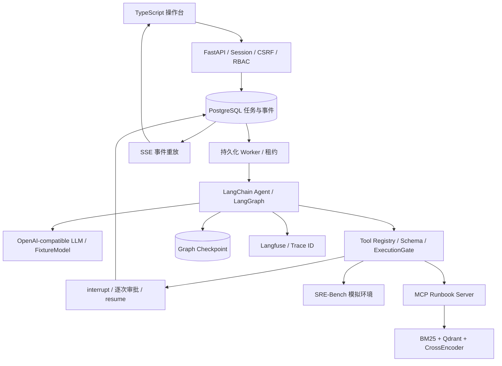

# IncidentSimulator

### 微服务异常诊断与自动化恢复 Agent 平台

**面向长程故障处置的 Agent 工程实践：把模型决策、工具治理、人工审批和持久化恢复连接成可追踪的执行闭环。**

`Python` · `FastAPI` · `LangChain / LangGraph` · `PostgreSQL` · `MCP` · `Hybrid RAG` · `Langfuse` · `TypeScript` · `Docker`

## 核心能力

- **受控 Agent Loop**：基于 LangChain Agent 和 LangGraph Checkpoint 组织多轮分析与工具交互；模型提出操作，应用层负责参数校验、执行授权和结果验证。
- **逐次审批与执行账本**：高风险操作绑定任务、参数摘要、环境版本及有效期；成功结果支持重放缓存，不确定结果进入人工核对状态，禁止盲目重试。
- **持久化任务调度**：FastAPI 与独立 Worker 分离；PostgreSQL 保存任务、审批和执行事件，Worker 通过租约领取任务并处理取消、超时及中断恢复。
- **可引用的知识检索**：版本化 Runbook → 分块 → BM25 / Qdrant 双路召回 → RRF 融合 → CrossEncoder 重排；通过 MCP Streamable HTTP 向 Agent 提供只读检索工具。
- **全流程观测**：统一任务 Trace ID 关联模型调用、工具执行与 Langfuse 观测；操作台通过 SSE 展示持久化事件与审批进度。
- **可审计评测**：代码硬检查、带版本与内容哈希的 Rubric、双 LLM Judge、固定任务分母聚合；未运行 Judge 时不生成模型准确率。

## 架构



## 故障场景与演示路径

| 场景 | 诊断证据 | 恢复操作 |
|---|---|---|
| 数据库连接池耗尽 | API/auth 日志、连接池指标 | 审批后清理连接并重启相关服务 |
| 日志磁盘占满 | 磁盘指标、应用日志 | 审批后清理场景允许的轮转日志 |
| 发布导致数据损坏 | 上下游日志、发布记录 | 分别审批版本回滚和受影响订单重处理 |

演示：登录 → 创建任务 → 查看检索与工具事件 → 审查操作理由、参数和影响 → 逐次批准 → 查看恢复报告和 Trace → 对终态任务执行评测。

## 工程设计

### 模型提出建议，应用控制执行

`StructuredTool` 暴露 Schema；`GovernedTools` 拦截工具调用；`ExecutionGate` 校验参数、风险、审批摘要和环境版本。工具派发前记录 RUNNING，成功后保存结果。图恢复时复用已成功操作的结果；无法确定副作用的操作停止并进入 `needs_review`。

### 长程执行与 HTTP 请求解耦

创建接口只写入 queued 任务。Worker 通过行锁和 `SKIP LOCKED` 领取任务，维护 30 秒租约与续期；应用快照和图 Checkpoint 分别保存。审批通过数据库重新入队，以 `Command(resume=True)` 恢复。当前不宣称跨外部系统 exactly-once。

### 知识与权限分离

MCP 只提供知识查询，不暴露恢复写操作。Runbook 以内容版本标识，检索返回引用、召回通道、重排分数。知识文本是参考材料，不能替代现场证据或人工授权。

## 快速启动

要求：Docker Engine / Compose；首次下载模型需要 Python 3.12 环境和网络。前端由 Docker 多阶段构建，不需要单独运行 Vite。

### 已配置的本机

在项目目录启动 Docker Desktop 后执行：

```powershell
powershell -ExecutionPolicy Bypass -File .\start-docker.ps1
```

脚本默认使用 `http://127.0.0.1:7897` 代理，可通过 `-Proxy` 指定。不要覆盖已有 `.env`。

### 首次部署

1. 复制 `.env.example` 为 `.env`；配置独立随机的 PostgreSQL 密码、MCP 服务令牌及 Langfuse 密钥。`LF_ENCRYPTION_KEY` 为 32 字节十六进制值。Langfuse 初始化项目 ID 为 `incident-project`；公私钥须与初始化配置一致。
2. 单独准备 [SRE-Bench](https://github.com/Neeln11/SRE-Bench) 环境，适配基线为 `f9d5e8ef8c28d2bb4895047d4473baa7b3b54153`。将目录绝对路径写入 `SRE_BENCH_PATH`。上游代码和模型权重不随仓库分发。
3. 准备本地检索模型：

```powershell
python -m venv .venv
.\.venv\Scripts\python -m pip install -e .
.\.venv\Scripts\python prepare-models.py --cache-dir C:/path/to/rag-models
```

将缓存绝对路径写入 `.env` 的 `RAG_MODEL_PATH`。

4. 启动服务（在项目根目录，固定 Compose 项目名以匹配观测网络）：

```powershell
docker compose -p incident-simulator up -d db qdrant
docker compose -p incident-observability -f compose.langfuse.yaml up -d
docker compose -p incident-simulator up --build -d
docker compose -p incident-simulator exec api python -m incident_simulator.manage create-user --username admin --role admin
```

最后一条仅首次创建管理员时执行，按提示设置密码。

- 操作台：<http://127.0.0.1:8765/>
- Langfuse：<http://localhost:3000/>；首次初始化用户 `admin@incident.local`，密码由 `LF_PASSWORD` 配置。
- 已配置本机的登录信息位于 `.local/`，该目录不会进入版本控制。

### 接入真实模型

在本地 `.env` 配置以下值，并重新创建 API / Worker 容器：

```dotenv
ENABLE_CLOUD_MODEL=true
LLM_MODEL=your-tool-calling-model
LLM_BASE_URL=https://your-provider.example/v1
LLM_API_KEY=your-local-secret
```

```powershell
docker compose -p incident-simulator up -d --force-recreate api worker
```

在操作台选择“云端模型”。模型需支持 OpenAI-compatible Chat Completions 和 Tool Calling。默认 `fixture` 模式使用确定性脚本模型，测试执行链而不调用付费 LLM；真实模型模式会产生供应商费用。CLI 入口直接使用真实模型配置，不受 Worker 云端开关控制。

### 查看状态与停止

```powershell
docker compose -p incident-simulator ps
docker compose -p incident-simulator logs --tail 100 api worker mcp
docker compose -p incident-simulator stop
docker compose -p incident-observability -f compose.langfuse.yaml stop
```

停止保留数据卷；`down -v` 会删除卷，不用于日常停止。

## 源码导航

| 模块 | 关键实现 |
|---|---|
| API / 权限 | `api.py`、`auth.py`：任务归属、会话、CSRF、角色授权、SSE |
| Worker / 数据 | `worker.py`、`database.py`：领取、续租、事件、快照 |
| Agent / 治理 | `runtime.py`、`governance.py`：Agent Loop、interrupt、Schema、执行账本 |
| 故障环境 | `environment.py`：外部模拟器适配、白名单工具、状态快照 |
| 模型 | `config.py`、`fixture_model.py`：真实模型与离线测试模式 |
| 知识与 MCP | `knowledge.py`、`retrieval.py`、`mcp_client.py`、`mcp_server.py` |
| 观测与评测 | `observability.py`、`evaluation.py` |
| 操作台 | `frontend/src/main.ts`、`integrations.ts` |

Python 模块位于 `src/incident_simulator/`。建议按 API → Worker → Runtime → ExecutionGate → Environment 的顺序阅读。

## 测试与质量检查

本次发布准备在本地执行：**25 项 unittest 全部通过，TypeScript 类型检查与 Vite 生产构建通过**。测试使用离线模型，没有付费 API 调用。

仓库包含 25 个 unittest 测试方法，覆盖精确审批、权限/CSRF、取消、工具预算、跨进程恢复、错误恢复声明、SSE 游标、评测分母和脱敏。

GitHub Actions 执行 10 项不依赖外部模拟环境的核心测试以及 TypeScript 检查/生产构建；需要 SRE-Bench 的 15 项集成测试单独执行。CI 配置不等于已经在 GitHub 上跑绿。

```powershell
$env:SRE_BENCH_PATH='C:/path/to/sre-bench'
$env:TEST_OUTPUT_DIR=(New-Item -ItemType Directory -Force .local/tests).FullName
$env:ENABLE_CLOUD_MODEL='false'
$env:LANGFUSE_ENABLED='false'
$env:MCP_URL=''
python -m unittest discover -s tests -v
cd frontend
npm ci
npm run build
```

平台自动化测试主要使用 SQLite，不能替代 PostgreSQL 锁竞争和多 Worker 压力测试。真实模型、双 Judge、MCP/Qdrant/Langfuse 的部署验收应单独记录，不以 fixture 成功率代替模型成绩。

## 实现边界与后续工作

- 当前是单 Agent、多轮工具交互与人工审批系统；没有自定义 `IncidentState` 或多智能体协作实现。
- 恢复验证依据模拟器终态，未连接生产微服务或独立探针。
- 评测实现包含固定分母和双 Judge；尚未发布固定 100 任务基准集或真实模型准确率。
- 未实施教师轨迹数据流水线、SFT/LoRA/DPO 训练，也不声明训练样本规模。
- 后续重点：真实模型回归集、PostgreSQL 并发/故障注入测试、人工核对恢复流程、依赖审计与更完整的观测故障隔离。

## 第三方来源与发布说明

SRE-Bench 作为外部环境引用，不包含在本仓库中；使用或再分发前核对其许可证。Embedding 使用 `sentence-transformers/paraphrase-multilingual-MiniLM-L12-v2`，重排使用 `jinaai/jina-reranker-v2-base-multilingual` 的 INT8 ONNX 权重，配置声明为 CC-BY-NC-4.0；模型权重单独下载，商业使用前确认授权。

本仓库尚未指定项目整体开源许可证，公开展示不代表已授予任意再分发权。发布时不要提交 `.env`、`.local/`、运行轨迹、日志、数据库或模型权重；默认忽略规则已覆盖这些文件。
